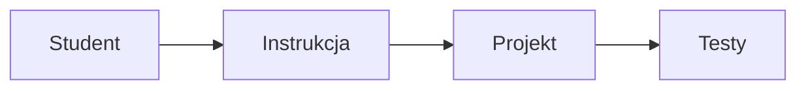

# LAB — Tytuł instrukcji

## Nazwa przedmiotu lub kursu

**Czas:** 90–120 minut zajęć; przygotowanie środowiska przed zajęciami, dokończenie implementacji, testów i README po zajęciach.

**Technologia:** uzupełnij technologie używane na laboratorium.

**Forma:** indywidualnie lub w parach.

**Rezultat:** opisz, co student powinien mieć po zakończeniu pracy.

## 1. Cele i zakres laboratorium

Po laboratorium powinieneś:

- wyjaśnić najważniejsze pojęcia;
- wykonać zadania w przygotowanym projekcie;
- zweryfikować rozwiązanie testami;
- opisać decyzje i ograniczenia w README.

### Zachowanie ciągłości projektu

| Etap wcześniejszy | Rozwinięcie w tym laboratorium |
| --- | --- |
| Dotychczasowe wymaganie | Co należy zachować |
| Istniejący kod i testy | Co należy rozwinąć |

## 2. Organizacja pracy

Opisz kolejność realizacji ćwiczeń, wymagane przygotowanie oraz punkt kontrolny na koniec zajęć.

### Przykładowy fragment kodu

```python
def example() -> str:
    return "Uzupełnij ćwiczenie"
```

### Przykładowy diagram



## 3. Kryteria zaliczenia

| Obszar | Wymaganie | Punkty |
| --- | --- | ---: |
| Implementacja | Rozwiązanie działa zgodnie z wymaganiami | 60 |
| Dokumentacja | README opisuje uruchomienie i weryfikację | 40 |
| **Razem** |  | **100** |
